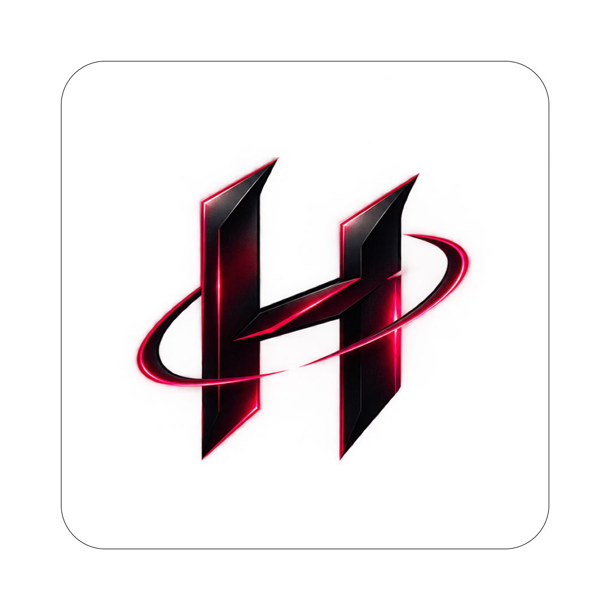

 <div align="center">

# 🔴 HAMI PARSA

### PERSONAL PORTFOLIO — A DIGITAL EXPERIENCE

**A cinematic, interactive personal portfolio built to showcase my skills, technologies, journey, and passion for web development.**

<br/>

<a href="https://YOUR-LIVE-WEBSITE-URL.com">
  
</a>
<a href="https://github.com/hamiparsa">
  
</a>

<br/><br/>



</div>

---

## 📌 About the Project

**Hami Parsa — Personal Portfolio** is a modern, cinematic portfolio website designed to present my identity, technical interests, development skills, and professional goals through a distinctive visual experience.

Built with a dark aesthetic, bold crimson and magenta accents, smooth animations, and responsive layouts, the website goes beyond a traditional portfolio to create a memorable digital identity.

The project focuses on clean implementation, thoughtful UI/UX, visual storytelling, and interactive details.

## ✨ Features

- 🎬 **Cinematic Hero Section** — A bold introduction with animated visual elements.
- 🧭 **Sticky Navigation** — Smooth navigation between sections.
- 👤 **About Me** — A personal introduction and development philosophy.
- 💻 **Expertise Section** — Highlights my areas of interest and technical focus.
- ⚡ **Technology Showcase** — A visual overview of the technologies and tools I work with.
- ♾️ **Animated Tech Marquee** — A continuous scrolling technology showcase.
- 🎨 **Distinctive Visual Identity** — Dark backgrounds with crimson and magenta accents.
- ✨ **Motion & Micro-interactions** — Carefully designed animations and transitions.
- 📱 **Fully Responsive Layout** — Optimized for desktop, tablet, and mobile devices.
- 🚀 **Projects Section** — A dedicated space for showcasing current and upcoming work.
- 🛤️ **Development Journey** — A visual overview of my learning and professional goals.
- ✉️ **Contact Section** — A dedicated way to get in touch, with EmailJS integration when configured.
- 🖱️ **Custom UI Details** — Scroll progress, custom cursor, and scrollbar styling.
- 🌐 **Deployment Ready** — Designed to be deployed with Vercel.

## 🧰 Tech Stack

| Technology | Purpose |
|---|---|
| ⚛️ **React** | Building interactive user interfaces |
| ▲ **Next.js** | App Router and application structure |
| 🟦 **TypeScript** | Type-safe and maintainable code |
| 🎨 **Tailwind CSS** | Responsive styling and visual design |
| ✨ **Motion** | Animations and interactive transitions |
| 🔷 **Simple Icons** | Consistent technology brand icons |
| ✉️ **EmailJS** | Contact form email delivery, when configured |
| ▲ **Vercel** | Deployment and hosting |

## 🖼️ Project Preview

<div align="center">


</div>

> **Note:** Add your actual screenshots to `docs/screenshots/` using the filenames above. These are preview placeholders until the images are added to the repository.

## 🛠️ Technologies I Explore

<div align="center">

### Frontend Development


### Backend & Databases


### Tools & Workflow


</div>

## 🧠 Design Philosophy

This project is built around a few core principles:

- **Clarity over complexity** — Every element should serve a purpose.
- **Details matter** — Small interactions can make a big difference.
- **Performance and responsiveness** — The experience should work across screen sizes.
- **Continuous learning** — Every project is an opportunity to improve.
- **Personal identity** — A portfolio should reflect its creator, not look like a generic template.

## 🚀 Getting Started

### Prerequisites

Make sure you have the following installed:

- [Node.js](https://nodejs.org/)
- npm, pnpm, yarn, or another supported package manager
- Git

### Installation

Clone the repository:

```bash
git clone https://github.com/hamiparsa/YOUR-REPOSITORY-NAME.git
```

Navigate to the project directory:

```bash
cd YOUR-REPOSITORY-NAME
```

Install the dependencies:

```bash
npm install
```

Start the development server:

```bash
npm run dev
```

Open [http://localhost:3000](http://localhost:3000) in your browser.

## ✉️ EmailJS Configuration

If the contact form uses EmailJS, create a `.env.local` file in the project root:

```env
NEXT_PUBLIC_EMAILJS_SERVICE_ID=your_service_id
NEXT_PUBLIC_EMAILJS_TEMPLATE_ID=your_template_id
NEXT_PUBLIC_EMAILJS_PUBLIC_KEY=your_public_key
```

Replace the example values with your actual EmailJS credentials.

**Important:** Never commit private credentials or secret keys to GitHub.

## 📁 Project Structure

The following is an illustrative structure. Adjust it to match the actual repository:

```text
.
├── app/
│   ├── layout.tsx
│   ├── page.tsx
│   └── globals.css
├── public/
│   └── logo.png
├── docs/
│   └── screenshots/
├── .env.local
├── package.json
├── tailwind.config.ts
├── tsconfig.json
└── README.md
```

## 🌍 Deployment

The portfolio can be deployed using [Vercel](https://vercel.com/).

1. Push the project to GitHub.
2. Import the repository into Vercel.
3. Configure the required environment variables if EmailJS is enabled.
4. Deploy the application.
5. Replace the live website URL at the top of this README with the actual deployment URL.

## 🗺️ Roadmap

- [x] Build the core portfolio experience
- [x] Establish a distinctive dark visual identity
- [x] Showcase technologies and areas of expertise
- [ ] Add real project screenshots
- [ ] Publish more completed projects
- [ ] Refine accessibility and performance
- [ ] Continue improving the experience as my skills grow

## 👨‍💻 About Me

**Hami Parsa** — Web Developer

I'm passionate about building modern web experiences, exploring technologies, solving problems, and continuously improving my software development skills.

My goal is to grow as a developer by building meaningful projects, strengthening my engineering fundamentals, and working toward international opportunities.

<div align="center">

<a href="https://github.com/hamiparsa">
  
</a>
<a href="https://www.linkedin.com/">
  
</a>

<br/><br/>

**Designed with purpose. Built with curiosity. Improved with every commit.**

⭐ If you like this project, consider giving the repository a star!

</div>
